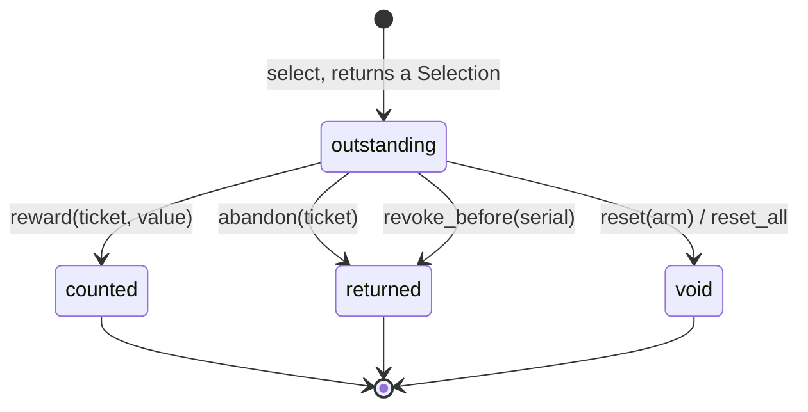
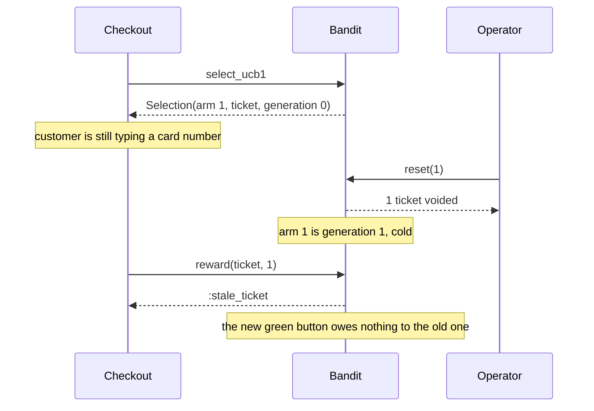

# BanditMachines

> You don't know which one is best. You still have to pick one now. 🎰

A multi-armed bandit for Ruby. You have a handful of options and no idea which pays best. Ask the bandit which to try, and it hands you an arm and a ticket. When you find out how it went, you hand the ticket back with a reward. It balances trying the arm that looks best against trying the ones it knows too little about, with UCB1 or epsilon-greedy, and it refuses a reward that shows up for an arm you've since reset.

This is an initial, unstable API. It is a policy core, not an experiment platform: it picks arms and counts rewards, and everything else is yours.

## Quick Start

```bash
gem 'bandit_machines'
```

```ruby
VARIANTS = %i[blue_button green_button orange_button].freeze
bandit = BanditMachines::Bandit.new(max_reward: 1, prior: 0)
VARIANTS.each_index { |arm| bandit.open(arm) }   # every arm starts closed

def show_checkout(bandit, session)
  selection = bandit.select_ucb1
  return render(VARIANTS.first) if selection.is_a?(Symbol) # :no_open_arm, :tickets_full and friends

  session[:ticket] = selection.ticket
  render(VARIANTS[selection.arm])
end

def checkout_finished(bandit, session, purchased)
  bandit.reward(session[:ticket], purchased ? 1 : 0)
end
```

One bandit, two ways to select, one way to report. A new bandit has every arm closed and selects nothing until you open some. Arms are indices, rewards are Integers from `0` to `max_reward`, and any randomness is a number you pass in.

## A Message to the Resistance

So you have three checkout buttons and a meeting where someone said "let's A/B test it." Two weeks at a third of the traffic each. For two weeks, two thirds of your customers get a button that, by the end, you'll know was worse. Then someone reads a p-value off a dashboard, ships the winner, and the test is over forever, including the day the winner stops winning.

Or you skip the meeting and write `variants.max_by { |v| v.conversions.fdiv(v.views) }`. The first variant to get a lucky sale wins every request from then on, and the other two never get a view to prove otherwise.

Or you write `rand < 0.1 ? variants.sample : best`. Now it works, and nobody can reproduce what it did on Tuesday, and the reward for a page shown before the redesign gets credited to the page that replaced it.

The piece you keep rebuilding is small: counts and sums per option, a rule for picking, and a way to say which pick a result belongs to. That piece is this gem.

## Chapter 1: Stardate 2026.316, the AMS Robbins

> **AMS Robbins**, NCC-4227, *Robbins*-class exploration scout.
> Every jump spent on a known system is a jump not spent finding a better one.

The scout doesn't mine anything. It decides where the next probe goes. Each system it could visit has a record: how many probes went out, how much they brought back, how many haven't reported yet. A system with a thin record gets the benefit of the doubt. A system with a thick record gets judged on it.

On a bridge somewhere, a cadet volunteers:

```ruby
def next_system
  @systems.max_by { |s| s.ore.fdiv(s.probes) }
end
```

"That," says the scout's navigator, "sends the whole fleet to the first rock that glittered."

## The Flight Plan

Each ticket the bandit issues is in one of these states:



And the afternoon the green button was redesigned while a customer was still at the till:



## How the Bandit Works

### Arms start closed

```ruby
bandit = BanditMachines::Bandit.new(max_reward: 10, prior: 5)
bandit.stats(0).open   # => false
bandit.select_ucb1     # => :no_open_arm

bandit.open(0)         # => true
bandit.open(1)         # => true
```

The bandit has 16 arms and a new one has all of them closed. It explores only what you open, so nothing is ever selected that you didn't name. Until you open an arm, both selections answer `:no_open_arm` and issue no ticket.

### Select with UCB1

```ruby
bandit = BanditMachines::Bandit.new(max_reward: 10, prior: 5)
2.times { |arm| bandit.open(arm) }

first = bandit.select_ucb1
first.arm      # => 0
first.reason   # => :cold_start
first.ticket   # => #<BanditMachines::Ticket>
```

An arm nobody has tried is *cold*, and cold arms go first, one per call. Once every arm has been tried, UCB1 scores each as `mean / max_reward + sqrt(2 * ln(total tries) / tries)` and takes the highest. A well-tried arm is judged on its mean. A neglected one gets a bonus that grows until it earns another look.

```ruby
bandit.reward(first.ticket, 0)                # arm 0 paid nothing
bandit.reward(bandit.select_ucb1.ticket, 10)  # arm 1 paid everything

third = bandit.select_ucb1
third.arm      # => 1
third.reason   # => :upper_bound
```

The score is computed with integers only, so it's the same on every machine. `ucb1_index_q56(arm)` shows it, scaled by `2**56`. It is never above the true value and less than `2**-26` below it.

### Select with epsilon-greedy

```ruby
selection = bandit.select_epsilon_greedy(
  numerator: 1, denominator: 10,   # explore one time in ten
  gate: rand(2**64),               # decides explore or exploit
  pick: rand(2**64)                # picks the arm when exploring
)
selection.reason   # => :explore or :exploit
```

The bandit has no random number generator. You supply two draws from `0..2**64-1`. It explores when `gate * denominator / 2**64` (rounded down) is below `numerator`, and then takes open arm number `pick * open_arms / 2**64`. Otherwise it takes the highest mean, compared exactly. Log the two draws and you can replay the decision.

Cold arms still go first, whatever the gate says.

### Reward

```ruby
bandit.reward(selection.ticket, 7)    # => true
bandit.reward(selection.ticket, 7)    # => :unknown_ticket, already spent
```

A ticket is good for one reward. A reward above `max_reward` answers `:reward_out_of_range` and leaves the ticket usable, so you can fix the value and try again.

### Abandon

A selection that will never have a result gets handed back. It's as if it never happened:

```ruby
selection = bandit.select_ucb1
bandit.abandon(selection.ticket)   # => true
```

### Waiting counts

Tickets that are out count as tries. Ask three times before any reward comes back and you get three different cold arms, not the same one three times. An arm with tickets out and no reward yet competes using `prior` as its mean.

```ruby
bandit = BanditMachines::Bandit.new(max_reward: 10, prior: 5)
3.times { |arm| bandit.open(arm) }
3.times.map { bandit.select_ucb1.arm }   # => [0, 1, 2]
bandit.stats(0).pending                   # => 1
bandit.stats(0).tries                     # => 1
```

### Ties

When two arms score exactly the same, `tie_break:` decides:

```ruby
BanditMachines::Bandit.new(max_reward: 1, prior: 0, tie_break: :draw)
```

`:lowest_index` (the default), `:highest_index`, `:least_tried` (fewest tries, then lowest index), or `:draw`, which spreads the tie evenly using your `pick`.

### Reset

```ruby
bandit = BanditMachines::Bandit.new(max_reward: 10, prior: 5)
2.times { |arm| bandit.open(arm) }
ticket = bandit.select_ucb1.ticket

bandit.reset(0)              # => 1, one ticket voided
bandit.reward(ticket, 10)    # => :stale_ticket
bandit.stats(0).generation   # => 1
```

Reset is for when an arm is no longer the thing it was. Its counts go to zero, its generation goes up, and every ticket issued before the reset is refused. `reset_all` does it to every arm.

### Decay

```ruby
bandit.decay(0, numerator: 1, denominator: 2)   # => true, arm 0 keeps half its history
bandit.decay_all(numerator: 9, denominator: 10) # => true
```

Decay is for when the world drifts and old results should weigh less. The reward count is multiplied by the fraction and rounded up, the sum is rounded down. Tickets are untouched: a reward that arrives after a decay still counts in full. Nothing decays unless you call it.

### Open and close

```ruby
bandit.close(1)   # => true, arm 1 is no longer selected
bandit.open(1)    # => true, and now it is again
bandit.open(1)    # => false, it already was
```

Opening is always explicit: the constructor opens nothing. A closed arm keeps its history and still accepts rewards for tickets issued before it closed. Wire this to whatever decides an option is available today.

### Revoke

```ruby
watermark = bandit.next_serial
# ... an hour later, by your clock ...
bandit.revoke_before(watermark)   # => how many tickets were abandoned
```

Every ticket has a `serial`, counting up. The bandit has no clock, so expiring old selections is yours: remember a serial, and later revoke everything before it.

### Capacity

```ruby
BanditMachines::ARM_CAPACITY      # => 16
BanditMachines::TICKET_CAPACITY   # => 64

bandit = BanditMachines::Bandit.new(max_reward: 1, prior: 0)
3.times { |arm| bandit.open(arm) }
64.times { bandit.select_ucb1 }
bandit.select_ucb1                # => :tickets_full
```

At most 64 selections can be waiting on a reward. Past that, selection is refused until a ticket is rewarded, abandoned, revoked or voided.

## The Rules of the Scout

- **Everything is an Integer.** Arms are `0...16`. Rewards, `max_reward`, `prior` and ratio terms are `0..2**32-1`. Draws and serials are `0..2**64-1`. Floats, nil, and strings raise `TypeError`. Out of range raises `RangeError`. An unknown `tie_break` or an unknown keyword raises `ArgumentError`.
- **Tickets belong to one bandit.** A `Ticket` from one `Bandit` is refused by another with `:unknown_ticket`. Tickets can't be built or copied by hand.
- **Refusals don't raise, and don't change anything.** `:no_open_arm`, `:tickets_full`, `:exhausted`, `:stale_ticket`, `:unknown_ticket`, `:reward_out_of_range` and `:saturated` are answers. Only malformed input raises.
- **No hidden randomness, no hidden clock.** The same calls with the same draws give the same answers.
- **Frozen means frozen.** `freeze` the bandit and every method that would change it raises `FrozenError`.

## What You Think You're Doing vs Reality

### You Think: "I'll show whichever variant has the best conversion rate."
### Reality: You're showing whichever variant got lucky first.

A rate built from four views is noise. Picking by rate alone locks in the early leader and starves the others of the views that would correct it. UCB1 adds a bonus for how little you know. Epsilon-greedy spends a fixed share of picks looking around.

### You Think: "The reward came back, so I'll add it to that arm."
### Reality: That arm was replaced an hour ago.

A result belongs to the selection that produced it, not to whatever sits in that slot now. The ticket carries the arm's generation. Reset the arm and the old ticket is dead.

### You Think: "UCB1 has a proven regret bound."
### Reality: For rewards that don't drift and feedback that doesn't wait.

Delayed rewards, resets and decay are tools for the real world. They work. They are not covered by the textbook proof, and this gem doesn't pretend otherwise.

## What's Yours

The bandit lives in your process and forgets everything when the process does. Persisting counts, sharing them between workers, and carrying a ticket across a request boundary are yours: `Ticket` is an in-memory object, not something to serialize. The random draws are yours, and so is their quality. Mapping a messy outcome onto `0..max_reward` is yours. Deciding when the world has changed enough to `reset` or `decay` is yours. Which arms are eligible, and what an arm means, is yours. The bandit recommends; it never routes traffic or flips a flag.

## License

MIT License. See [LICENSE.txt](LICENSE.txt) for details.

**Remember: the best arm so far is not the best arm. It's the best arm you've looked at.**
